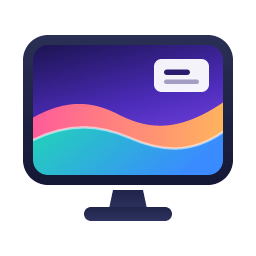
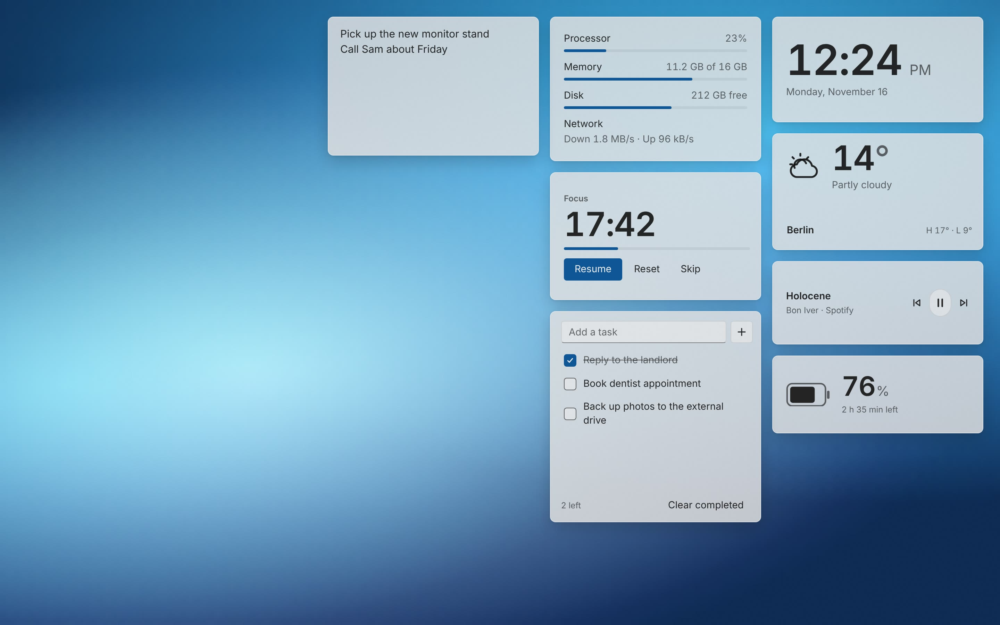
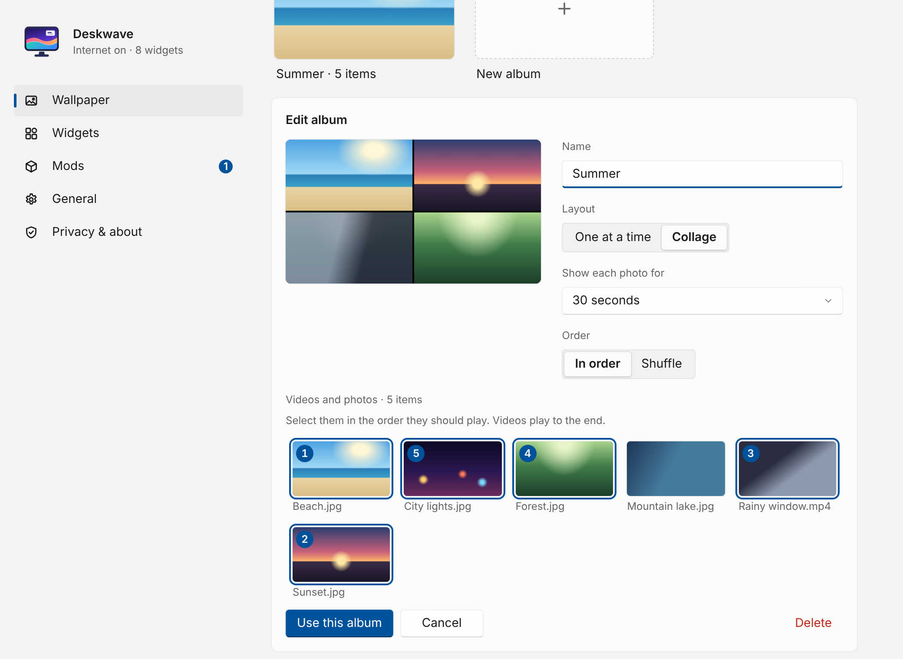
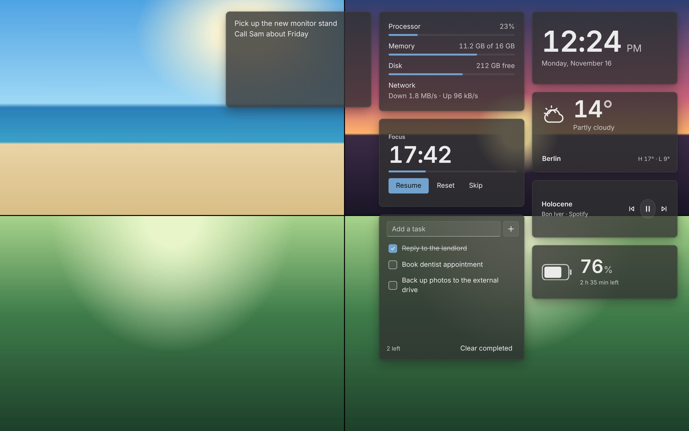
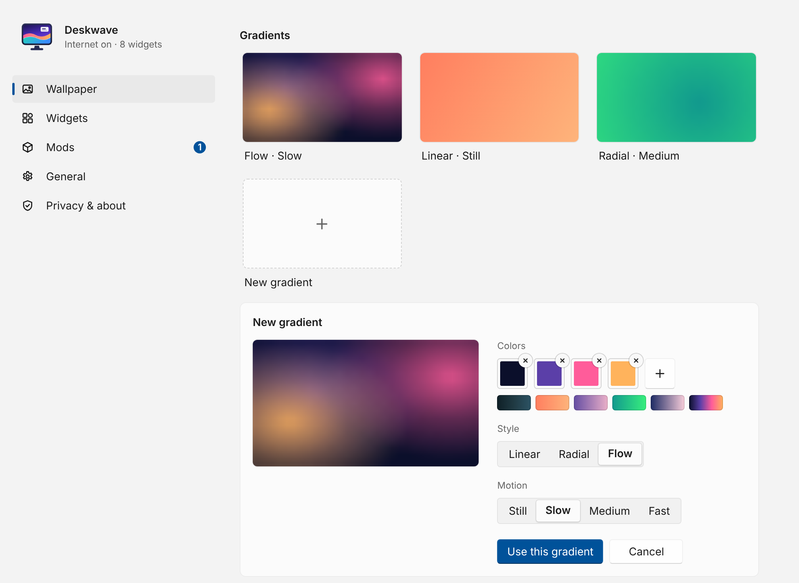
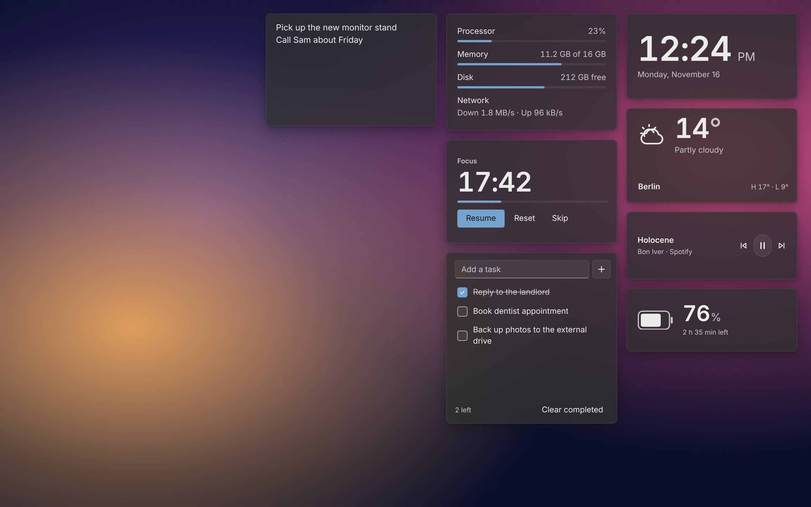
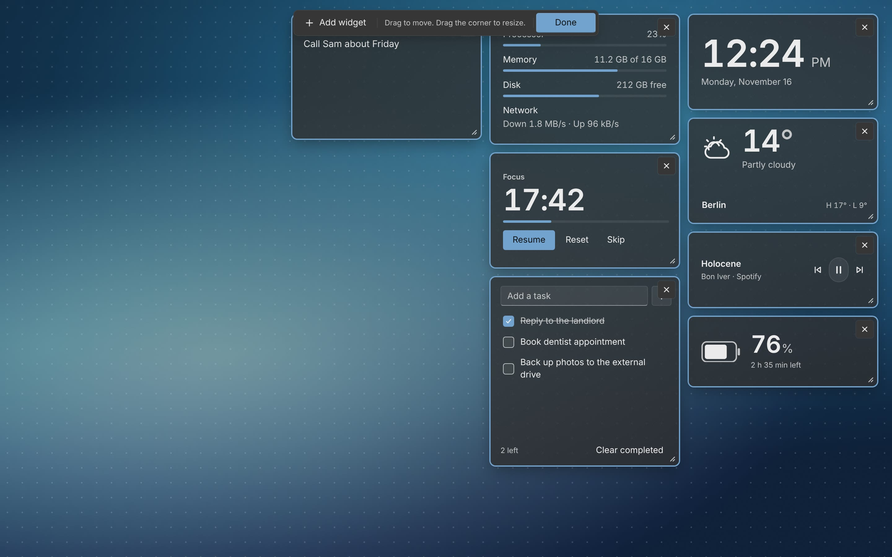
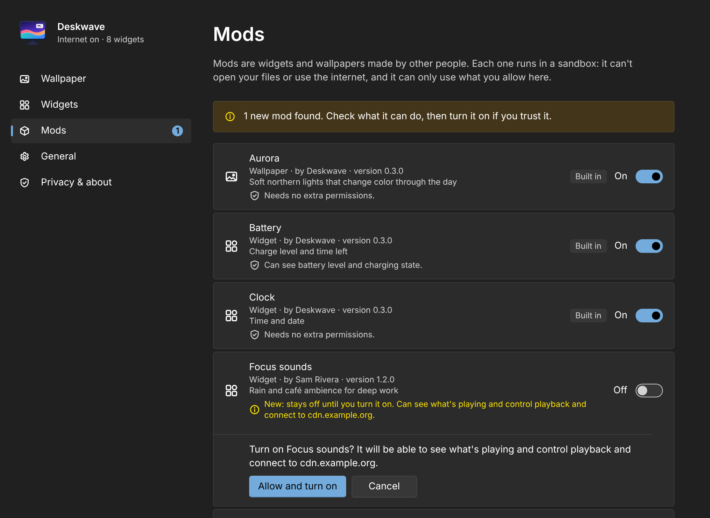
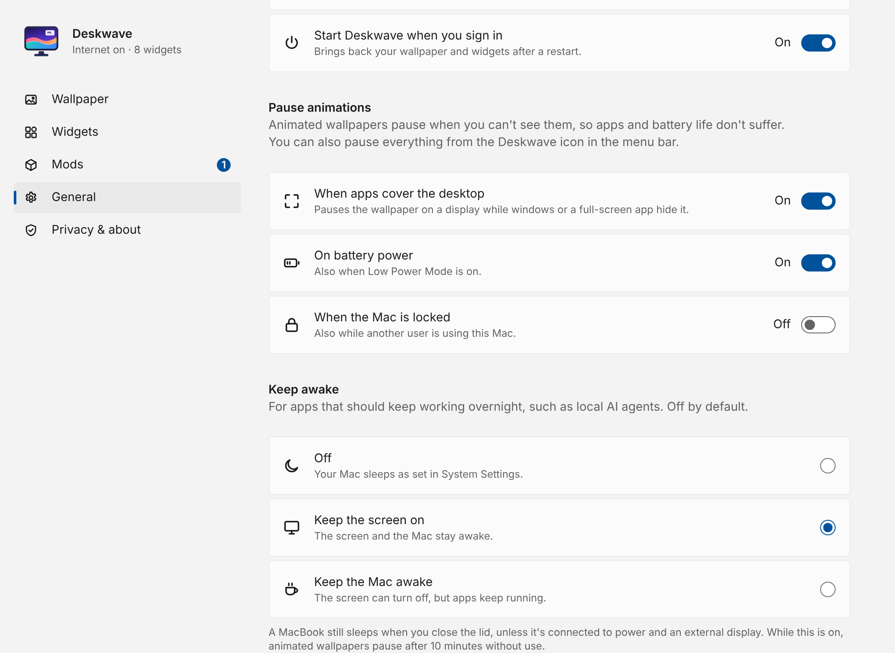
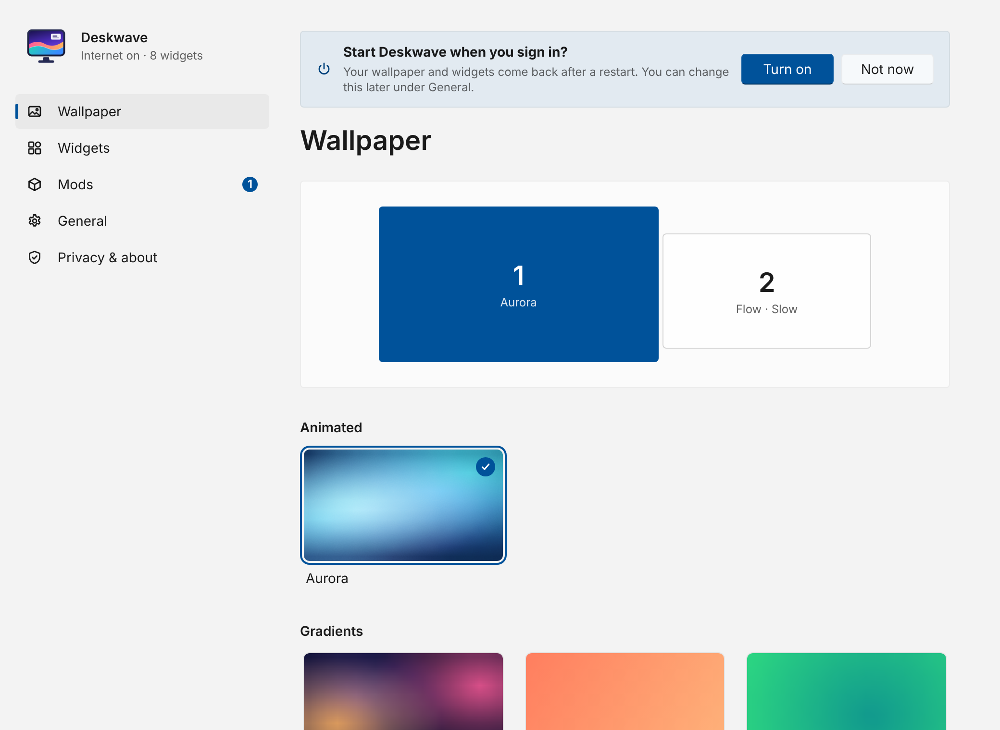

<!--
  The pictures in docs/images are rendered from Deskwave's real interface with sample data.
  To swap in real screenshots, replace the files in docs/images and keep the same file names.
-->

<p align="center">
  
</p>

<h1 align="center">Deskwave</h1>

<p align="center">
  <b>Animated wallpapers and desktop widgets for Windows and macOS.</b><br>
  Private, offline by default, free for non-commercial use.
</p>

<p align="center">
  <a href="https://github.com/sharabarinillia/Deskwave/releases/latest/download/Deskwave-Setup.exe"><b>Download for Windows</b></a> ·
  <a href="https://github.com/sharabarinillia/Deskwave/releases/latest/download/Deskwave-macOS.dmg"><b>Download for Mac</b></a> ·
  <a href="https://github.com/sharabarinillia/Deskwave/releases/latest">All downloads</a> ·
  <a href="#install">Install guide</a> ·
  <a href="#features">Features</a> ·
  <a href="#privacy-and-security">Privacy and security</a> ·
  <a href="#write-your-own-widget">Write a widget</a>
</p>

<p align="center">
  <a href="https://github.com/sharabarinillia/Deskwave/actions/workflows/ci.yml"></a>
</p>



Deskwave plays a moving wallpaper behind your desktop icons and lets you pin the widgets you need
to the desktop itself, on Windows and on a Mac. Everything runs on your computer. Deskwave has no
account, sends no data about you, and doesn't touch the internet unless you switch it on.

## Contents

- [Features](#features)
- [Install](#install): [Windows](#windows-step-by-step) · [Mac](#mac-step-by-step) · [advanced](#advanced-install)
- [Windows Defender or SmartScreen warns about the file](#windows-defender-or-smartscreen-warns-about-the-file)
- [macOS says it can't check Deskwave](#macos-says-it-cant-check-deskwave)
- [Using Deskwave](#using-deskwave)
- [Privacy and security](#privacy-and-security)
- [Write your own widget](#write-your-own-widget)
- [Uninstall](#uninstall)
- [No warranty](#no-warranty)
- [Build from source](#build-from-source)
- [License](#license)

## Features

### Wallpapers that move

- **Aurora**, a built-in animated wallpaper: soft northern lights that change color through the day.
- **Your own videos and images:** `.mp4`, `.webm`, `.gif`, `.png`, `.jpg` and `.webp`. Drag them
  straight into the Settings window.
- **Albums.** Videos and photos take turns as your wallpaper:
  - one at a time, or as a collage of up to four;
  - photos stay up from 5 seconds to an hour, and videos play to the end;
  - in your order, or shuffled.
- **Gradient creator.** Make your own still or moving gradient:
  - 2 to 5 colors, or start from a palette;
  - three styles: linear (with an angle), radial and flow;
  - four speeds: still, slow, medium and fast.
- **A different wallpaper on each display.**

| Make an album | A collage on the desktop |
|---|---|
|  |  |
| **Make a gradient** | **A gradient on the desktop** |
|  |  |

### Widgets on your desktop

| Widget | What it shows | Uses the internet |
|---|---|---|
| Clock | Time and date in your language | No |
| Notes | A note that stays on your desktop | No |
| To-do | A short list of things to get done | No |
| Focus timer | 25 minutes of focus, then a 5-minute break | No |
| Battery | Charge level and time left (laptops) | No |
| System | Processor, memory, disk and network use | No |
| Now playing | What's playing in any app, with play, pause and skip (Windows only) | No |
| Weather | Current weather and today's high and low | Yes, only when you allow it |

macOS doesn't let apps see or control what other apps are playing, so Now playing is Windows only.

Move, resize, add and remove widgets right on the desktop:



### Made to stay out of your way

- **Light on your computer.** Animations pause when you can't see them:
  - while a game, video or other app covers the desktop;
  - on battery;
  - while the computer is locked.
- **Keeps your Mac awake, if you ask.** For local AI agents and other work that runs overnight:
  - keep the screen on, or only the Mac;
  - off by default, and also in the menu bar icon's menu;
  - while it's on, animations pause after 10 minutes without use.
- **Feels at home.** It follows light and dark mode and your accent color, works with the keyboard
  and screen readers, and calms its animations when the system is set to show fewer.
- **Speaks your language.** English, Українська, Français, Nederlands, Deutsch, Polski and
  Español. It follows your system language, or you can pick one in Settings.
- **Extendable.** Anyone can write widgets and wallpapers ("mods") in HTML, CSS and JavaScript.
  Each one runs in a sandbox and stays off until you approve it.

| Mods, in dark mode | Keep awake, on a Mac |
|---|---|
|  |  |

## Install

**You need:** Windows 10 or 11 (64-bit), or macOS 12 Monterey or later on an Apple Silicon or
Intel Mac.

> [!WARNING]
> **Only download Deskwave from this repository's
> [Releases page](https://github.com/sharabarinillia/Deskwave/releases).** Copies from anywhere
> else may have been changed and are not safe.

Every release has these files under **Assets**:

| File | Who it's for |
|---|---|
| **[Deskwave-Setup.exe](https://github.com/sharabarinillia/Deskwave/releases/latest/download/Deskwave-Setup.exe)** | **Most people.** Installs for your account only. No administrator rights needed. |
| [Deskwave.msi](https://github.com/sharabarinillia/Deskwave/releases/latest/download/Deskwave.msi) | IT admins and managed PCs. Installs for all users. Needs administrator rights. |
| [Deskwave-Windows.zip](https://github.com/sharabarinillia/Deskwave/releases/latest/download/Deskwave-Windows.zip) | Both Windows installers in clearly named folders, with a READ ME FIRST file. |
| **[Deskwave-macOS.dmg](https://github.com/sharabarinillia/Deskwave/releases/latest/download/Deskwave-macOS.dmg)** | **Macs.** The app, a shortcut to drag it into Applications, and a READ ME FIRST file. |
| [SHA256SUMS.txt](https://github.com/sharabarinillia/Deskwave/releases/latest/download/SHA256SUMS.txt) | Fingerprints to check your download is genuine (see [advanced](#advanced-install)). |

Ignore the **Source code** files that GitHub adds to every release: they hold the project's code,
not the app.

Inside `Deskwave-Windows.zip`:

```text
1 - Setup (recommended)/Deskwave-Setup.exe
2 - MSI (for IT admins)/Deskwave.msi
READ ME FIRST.txt
SHA256SUMS.txt
```

### Windows, step by step

1. Select **[Download Deskwave-Setup.exe](https://github.com/sharabarinillia/Deskwave/releases/latest/download/Deskwave-Setup.exe)**. It downloads to your
   **Downloads** folder.
2. Open the file you downloaded.
3. Windows may show a blue box that says **"Windows protected your PC"**. This is normal for new
   apps that aren't signed with a paid certificate (see
   [why](#windows-defender-or-smartscreen-warns-about-the-file)). If you downloaded the file with
   the link in step 1:
   1. select **More info**;
   2. check that the app name starts with **Deskwave**;
   3. select **Run anyway**.

   If you got the file anywhere else, delete it instead.
4. The installer shows a warning and the license. Read it, then select **I Agree**.
5. Select **Next**, then **Install**, then **Finish**.
6. Deskwave opens its Settings window. It asks whether to start Deskwave when you sign in: select
   **Turn on** to keep your wallpaper and widgets after a restart, or **Not now**.

   

Next time, open Deskwave from the **Start menu**. You'll also find its icon in the taskbar corner
(select the **^** arrow next to the clock if you don't see it).

### Mac, step by step

1. Select **[Download Deskwave-macOS.dmg](https://github.com/sharabarinillia/Deskwave/releases/latest/download/Deskwave-macOS.dmg)**. It downloads to your
   **Downloads** folder.
2. Open the file you downloaded. In the window that appears, drag **Deskwave** onto
   **Applications**.
3. Open Deskwave from **Applications** or **Launchpad**.
4. The first time, macOS says it can't check Deskwave for malicious software. This is normal for
   apps that aren't notarized through Apple's paid program (see
   [why](#macos-says-it-cant-check-deskwave)). If you downloaded the file with the link in step 1:
   - **macOS 15 Sequoia or later:** select **Done**, then open **System Settings → Privacy &
     Security**. Scroll down, select **Open Anyway** next to the message about Deskwave, and
     confirm.
   - **macOS 12 to 14:** Control-click Deskwave in Applications, choose **Open**, then select
     **Open** again.

   If you got the file anywhere else, delete it instead.
5. Deskwave opens its Settings window and asks whether to start when you sign in. If you select
   **Turn on**, macOS shows a "Background Items Added" notice: that's Deskwave's sign-in entry.

Next time, open Deskwave from Launchpad or Spotlight. Its icon also sits in the menu bar.

### Advanced install

**Check the download is genuine.** Compare the file's SHA-256 checksum with the line for that file
in `SHA256SUMS.txt` from the same release. Upper or lower case doesn't matter.

On Windows, in PowerShell:

```powershell
(Get-FileHash .\Deskwave-Setup.exe -Algorithm SHA256).Hash
```

On a Mac, in Terminal:

```bash
shasum -a 256 ~/Downloads/Deskwave-macOS.dmg
```

**Check where it was built.** Releases of the public repository carry a signed
[build provenance attestation](https://docs.github.com/actions/security-for-github-actions/using-artifact-attestations).
It proves the file was built by this repository's release workflow on GitHub's own servers, from a
tagged commit. With the [GitHub CLI](https://cli.github.com):

```bash
gh attestation verify Deskwave-Setup.exe --repo sharabarinillia/Deskwave
```

**Install without questions** (Windows, both installers):

```powershell
.\Deskwave-Setup.exe /S
```

```powershell
msiexec /i Deskwave.msi /qn
```

The MSI command needs an administrator terminal.

**Start without opening Settings:** run the app with `--background`. The sign-in entry uses this.

**Where things are:**

| What | Windows | Mac |
|---|---|---|
| App | `%LOCALAPPDATA%\Deskwave` (setup.exe) | `/Applications/Deskwave.app` |
| Settings and widget data | `%APPDATA%\Deskwave\config.json` and `storage\` | `~/Library/Application Support/Deskwave/config.json` and `storage/` |
| Your wallpapers | `%APPDATA%\Deskwave\wallpapers` | `~/Library/Application Support/Deskwave/wallpapers` |
| Third-party mods | `%APPDATA%\Deskwave\mods` | `~/Library/Application Support/Deskwave/mods` |
| Start at sign-in (only if you turned it on) | `HKCU\Software\Microsoft\Windows\CurrentVersion\Run`, value `Deskwave` | `~/Library/LaunchAgents/app.deskwave.desktop.plist` |

Deskwave installs no services, scheduled tasks or drivers. The app itself never asks for
administrator rights.

## Windows Defender or SmartScreen warns about the file

**Why it happens.**
- **SmartScreen** trusts files by reputation. A new app that isn't signed with a paid
  code-signing certificate starts with none, so Windows asks before running it.
- **Microsoft Defender** sometimes flags unsigned apps built with Rust and Tauri, the tools Deskwave
  uses, with a "machine learning" detection whose name ends in `!ml` (often
  `Trojan:Win32/Wacatac.B!ml`). This is a guess from the file's shape, not a match with known
  malware, and it's a
  [known false positive](https://github.com/tauri-apps/tauri/issues?q=is%3Aissue+wacatac) for apps
  built this way.

**What Deskwave does about it:**
- The installer downloads nothing. If your PC lacks Microsoft's WebView2, which Windows 11 always
  has, Microsoft's own signed setup inside the installer adds it.
- Deskwave doesn't add itself to startup unless you say yes.
- It needs no administrator rights, opens no ports and runs no background services.
- Every release is built on GitHub's servers from this public source code, with checksums and a
  signed build provenance attestation.

**What you can safely do:**
1. Only download Deskwave from this repository's
   [Releases page](https://github.com/sharabarinillia/Deskwave/releases).
2. [Check the checksum](#advanced-install). If it matches, the file is exactly what was built here.
3. For a second opinion, you can upload the file to [VirusTotal](https://www.virustotal.com), which
   checks it with about 70 virus scanners.
4. If Defender quarantined the file and the checksum matches, report the mistake to Microsoft at
   [microsoft.com/wdsi/filesubmission](https://www.microsoft.com/en-us/wdsi/filesubmission).
   Choose **Incorrectly detected as malware/malicious**. Once Microsoft clears it, update Defender
   (Windows Security → Virus & threat protection → Protection updates) and download the file again.

**Never** turn off Microsoft Defender or add exclusions to get Deskwave running. Never run a copy
from another website, even if it has the same name.

## macOS says it can't check Deskwave

**Why it happens.** macOS fully trusts apps that Apple has notarized. Notarization needs a paid
Apple Developer membership, which Deskwave doesn't have yet. So the first time you open it, macOS
asks you to confirm.

**What Deskwave does about it:**
- The app is signed, so macOS can tell if anyone changed it after it was built.
- It's built on GitHub's servers from this public source code, with checksums and a signed build
  provenance attestation.
- It needs no administrator rights and adds itself to sign-in only if you say yes.

**What you can safely do:**
1. Only download Deskwave from this repository's
   [Releases page](https://github.com/sharabarinillia/Deskwave/releases).
2. [Check the checksum](#advanced-install).
3. Allow it once with **Open Anyway**, as in [Mac, step by step](#mac-step-by-step).

**Never** turn off Gatekeeper or other protections, and don't paste Terminal commands from other
websites to get Deskwave running.

## Using Deskwave

- **Open Settings:** open Deskwave from the Start menu or Launchpad, or select its icon in the
  taskbar corner (Windows) or menu bar (Mac).
- **Icon menu** (right-click, or Control-click on a Mac): Open Deskwave, Edit widgets, Pause
  animations, Quit Deskwave. On a Mac it also has **Keep screen awake**.
- **See your widgets:** they sit on the desktop behind your apps. Press **Windows logo key + D**,
  or on a Mac press **Fn + F11** or spread your thumb and three fingers on the trackpad.
- **Arrange widgets:** select **Edit widgets**, then:
  - drag a widget to move it;
  - drag its corner to resize it;
  - select **×** to remove it, or **Add widget** for more;
  - press **Esc** or select **Done** when you're finished.

  With the keyboard, arrow keys move the focused widget and Shift + arrow keys resize it.
- **Change the wallpaper:** **Wallpaper** page. Pick a display, then select a wallpaper.
  - For your own files, drag your videos or photos into the Settings window. Or select **Open
    folder**, copy them into it, then select **Refresh**.
  - For an album, select **New album**. Select videos and photos in the order they should play,
    choose one at a time or a collage, how long each photo stays up, and the order. Then select
    **Use this album**. Files you drag in while the album is open are added to it.
  - For a gradient, select **New gradient**. Choose colors, a style and a motion, then select
    **Use this gradient**.

  To change or remove an album or gradient later, select **Edit** on its tile.
- **Language, startup and pausing:** **General** page.
- **Keep awake (Mac):** **General** page, or the menu bar icon. While it's on, macOS lists
  "Deskwave: Keep awake is on" in Activity Monitor's Energy tab and in `pmset -g assertions`. It
  ends when you turn it off or quit Deskwave. A MacBook still sleeps when you close the lid unless
  it's connected to power and an external display.
- **Internet and recent activity:** **Privacy & about** page.

## Privacy and security

- **Offline by default.** Deskwave makes no network requests until you turn on **Let widgets use the
  internet** under Privacy & about.
- **When the internet is on:**
  - only widgets you approved can connect, and only to the sites they list;
  - connections are HTTPS-only, never redirected, never sent to your home or office network, and
    limited to 30 a minute for each widget;
  - every request appears under **Recent internet activity**;
  - the built-in Weather widget only talks to Open-Meteo: `geocoding-api.open-meteo.com` to find the
    city you type, `api.open-meteo.com` for the forecast. No API key, no account.
- **No telemetry.** No analytics, crash uploads or automatic update checks, and no account.
- **Nothing can connect in.** Deskwave runs no server and opens no ports.
- **Sandboxed mods.** Each mod runs in a locked-down sandbox:
  - it can't read your files, other widgets' data or the app's internals;
  - it can't use the camera, microphone or location;
  - new mods stay off until you approve them, and the approval screen lists exactly what each one
    can do.

The full design is in [docs/SPEC.md](docs/SPEC.md#sandbox-defence-in-depth). To report a
vulnerability privately, see [SECURITY.md](SECURITY.md).

## Write your own widget

A widget is a folder with a `manifest.json` and ordinary web files. Here is a complete one that
counts clicks and remembers the count.

`hello/manifest.json`:

```json
{
  "id": "yourname.hello",
  "name": "Hello",
  "version": "1.0.0",
  "kind": "widget",
  "entry": "index.html",
  "author": "Your name",
  "description": "Counts clicks",
  "size": { "w": 240, "h": 120 }
}
```

`hello/index.html`:

```html
<!doctype html>
<html lang="en">
<head>
  <meta charset="utf-8">
  <link rel="stylesheet" href="/_sdk/deskwave.css">
  <script src="/_sdk/deskwave.js" defer></script>
  <script src="main.js" defer></script>
</head>
<body>
  <button class="dw-btn primary" id="hello">Clicked 0 times</button>
</body>
</html>
```

`hello/main.js`:

```js
const button = document.getElementById('hello');
let count = 0;

deskwave.ready.then(async () => {
  count = (await deskwave.storage.get('count')) ?? 0;
  button.textContent = `Clicked ${count} times`;
});

button.addEventListener('click', () => {
  count += 1;
  button.textContent = `Clicked ${count} times`;
  deskwave.storage.set('count', count);
});
```

To try it:
1. Open Settings → Mods and drag the `hello` folder into the window. Or select **Open folder**,
   copy the folder in, then select **Refresh**.
2. Turn the mod on.
3. Under **Edit widgets**, select **Add widget**.

Widgets can also:
- read the battery, system stats or media (with the matching permission);
- fetch from sites they declare;
- translate themselves into all seven languages.

The [mod reference](docs/SPEC.md#mods) has the details, and the built-in widgets in [`mods/`](mods)
are working examples. Mod ids starting with `deskwave.` are reserved for built-ins.

## Uninstall

**Windows:**

1. Right-click the Deskwave icon in the taskbar corner and select **Quit Deskwave**.
2. Open **Settings → Apps → Installed apps**, find **Deskwave**, then select **⋯ → Uninstall**.
3. In the setup.exe uninstaller, tick **Delete the application data** to also remove your settings
   and widget data. Your own wallpapers and mods in `%APPDATA%\Deskwave` are kept. Delete that
   folder yourself if you don't need them.

The uninstaller also removes the start-at-sign-in entry. If you used the MSI, turn off
**Start Deskwave when you sign in** (General page) before uninstalling.

**Mac:**

1. In Deskwave's Settings, turn off **Start Deskwave when you sign in** (General page).
2. Select the Deskwave icon in the menu bar and choose **Quit Deskwave**.
3. Drag **Deskwave** from Applications to the Trash.
4. To also remove your settings, wallpapers and mods, delete
   `~/Library/Application Support/Deskwave`.

## No warranty

Deskwave is provided "as is", without any warranty of any kind. You install and use it at your
own risk. To the fullest extent permitted by law, the author is not liable for any damage or loss
caused by this program or by its use, including damage caused by copies obtained anywhere other
than this repository's [Releases page](https://github.com/sharabarinillia/Deskwave/releases).

## Build from source

You need [Rust](https://rustup.rs) and [Node.js](https://nodejs.org) 22. On a Mac, also the Xcode
Command Line Tools (`xcode-select --install`).

```bash
npm ci
```

```bash
npm run dev
```

```bash
npm run build
```

On Windows, `npm run build` writes both installers to `target/release/bundle/`. On a Mac, build
the app for Apple Silicon and Intel instead:

```bash
npx tauri build --target universal-apple-darwin --bundles app
```

Then `npm run package` (with `target/universal-apple-darwin/release/bundle` on a Mac) gathers
everything into `dist/`, with the same names and folders as a release.

The core logic builds and tests on any OS. It covers manifest checks, sandbox headers, config,
storage and languages.

```bash
cargo test -p deskwave-core
```

To check that every language has every text:

```bash
npm run check-strings
```

| Path | What |
|---|---|
| `crates/deskwave-core` | Platform-independent logic, unit-tested |
| `src-tauri` | The app (Tauri 2 and Rust); what differs between Windows and macOS is in `src/platform` |
| `ui` | Settings window, widget layer and wallpaper pages, with all translations |
| `sdk` | Script and styles that mods include |
| `mods` | Built-in widgets and wallpapers |
| `docs/SPEC.md` | Architecture, security model and roadmap |

Releases are built and published by
[`.github/workflows/release.yml`](.github/workflows/release.yml) when a version tag such as
`v0.4.0` is pushed, or when a release with a new tag is published on the Releases page. The title
and notes come from `docs/releases/<tag>.md`, so write that file first.

## License

**ONLY FOR UNPAID USAGE. CHARGING ANY KIND OF FEES IS PROHIBITED.**

Deskwave is licensed under the [PolyForm Noncommercial License 1.0.0](LICENSE). You may use, share
and change it for any non-commercial purpose. You may not sell it, charge for it, or use it to
make money in any other way.

Made by [sharabarinillia](https://github.com/sharabarinillia).
